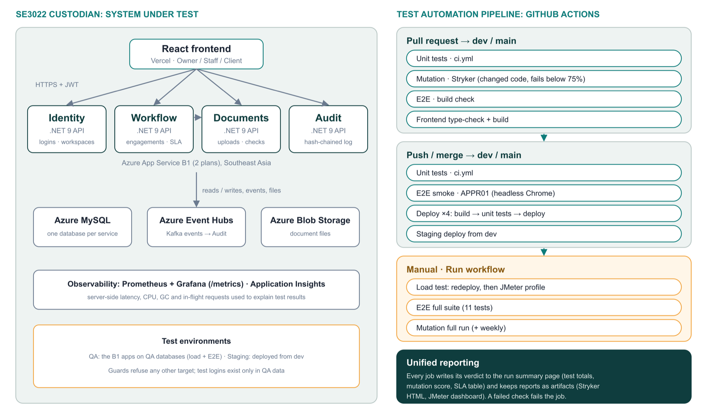

# Testing Pipeline (SE3112)

The Custodian platform is tested in four layers. Each layer is owned by one team member, and all four run in
GitHub Actions: fast checks on every pull request and push, heavy checks from the **Run workflow** button.



## Contents

- [Team and roles](#team-and-roles)
- [Tool setup](#tool-setup)
- [Running the tests locally](#running-the-tests-locally)
- [The pipeline in GitHub Actions](#the-pipeline-in-github-actions)
- [The four layers](#the-four-layers)
- [Test environments and safety](#test-environments-and-safety)
- [Known issues](#known-issues)

## Team and roles

| Role | Owner | Tools | Where |
| ---- | ----- | ----- | ----- |
| Unit Testing & Mocking | Rithish | xUnit, Moq, EF Core InMemory | `backend/tests/` (5 test projects) |
| Mutation Testing | Shajeeve | Stryker.NET 4.16.0 | `backend/tests/*/stryker-config.json`, `.github/workflows/mutation-tests.yml` |
| UI / E2E Testing | Mohamed Ilzam | Selenium WebDriver 4.48, xUnit, PdfPig | [`tests/selenium/`](tests/selenium/README.md) |
| Load & Performance Testing | Gunitha Rathnayake | Apache JMeter 5.6.3 | [`tests/jmeter/`](tests/jmeter/README.md) |

## Tool setup

| Layer | Install | Configure |
| ----- | ------- | --------- |
| Unit | .NET 9 SDK | Nothing: the tests use in-memory databases and mocks |
| Mutation | .NET 9 SDK | `dotnet tool restore` installs Stryker.NET from `.config/dotnet-tools.json` |
| E2E | .NET 10 SDK, Google Chrome | Copy `tests/selenium/.env.example` to `tests/selenium/.env.e2e.local` (git-ignored) and fill in the four QA accounts: owner, staff, client and Stage 2 client |
| Load | Java 17+, Apache JMeter 5.6.3 (`brew install jmeter`), Node.js 20 | Copy `tests/jmeter/data/accounts.example.csv` to `accounts.csv` (git-ignored) and fill in the QA Owner login |

## Running the tests locally

Run every command from the repository root.

### Unit tests

```bash
dotnet test backend/Custodian.sln
```

About 1.5 minutes. A pass prints one `Passed!` line per test project with `Failed: 0`: 2,422 tests pass across
Workflow, Audit, Documents, Identity and Shared (41 are skipped: they need a live database).

### Mutation tests

Run Stryker inside one test project (the HTML report is written to `StrykerOutput/` in that folder):

```bash
cd backend/tests/Custodian.Workflow.Tests && dotnet tool restore && dotnet stryker
```

A pass ends with `The final mutation score is NN.NN %`. Run time grows with the project: about 1 minute for
`Custodian.Shared.Tests` and about 27 minutes for `Custodian.Workflow.Tests` in CI.

### E2E tests

Headless, all routine tests:

```bash
SELENIUM_HEADLESS=true DOTNET_ROLL_FORWARD=Major dotnet test tests/selenium/Custodian.System.Tests/Custodian.System.Tests.csproj --filter "Category=CI"
```

A pass ends with `Passed!` and `Failed: 0` for the 11 tests. On Windows, `tests/selenium/run-demo.ps1` runs the same
suite with visible Chrome (`-QuickDemo` runs only the APPR01 approval workflow, in about a minute). The golden-path
test E2E06 (about 9 minutes) runs only with `RUN_GOLDEN_PATH_E2E=true`.

### Load tests

```bash
cd tests/jmeter && ./run.sh smoke --props qa.properties
```

About 2 minutes (health check, warm-up, test, gate). A pass ends with `RESULT: PASS` and exit code 0; the HTML
dashboard is in `tests/jmeter/reports/latest/index.html`. Replace `smoke` with `load`, `stress` or `spike` for the
other profiles.

## The pipeline in GitHub Actions

| Workflow (name in the Actions tab) | Layer | Pull request to `dev` / `main` | Push to `dev` / `main` | Run workflow button |
| ---------------------------------- | ----- | ------------------------------ | ---------------------- | ------------------- |
| `ci.yml` (CI — Build & Test) | Unit | Yes, backend changes | Yes, backend changes | No |
| `mutation-tests.yml` (Mutation Tests — Backend) | Mutation | Yes, backend changes: changed code only, fails below `BREAK_AT` (75%) | No | Yes: full run of every project; also Mondays 02:00 UTC |
| `e2e-pipeline.yml` (CI — E2E Testing Pipeline (Role D)) | E2E | Build check only (browser tests need the account secrets) | Yes: smoke test (APPR01) | Yes: smoke or full suite (11 tests) |
| `load-test.yml` (Load Test — JMeter (manual)) | Load | No | No | Yes: redeploys the four services, then runs the chosen profile |
| `deploy-*.yml` (Deploy — *Service*) | Unit, then deploy | No | `main`: build, unit tests, deploy | Yes |

**Starting a run by hand:** GitHub → **Actions** → pick the workflow on the left → **Run workflow** → choose the
branch and options. From a terminal with the GitHub CLI, for example:

```bash
gh workflow run load-test.yml --ref main -f run_load_test=true -f profile=smoke
```

```bash
gh workflow run e2e-pipeline.yml --ref main -f test_suite=full
```

```bash
gh workflow run mutation-tests.yml --ref main
```

**Why load tests are manual only:** they measure the deployed environment, so a pull-request run would test the
code already deployed rather than the pull request's; they would overlap the E2E tests and deployments that run on
every push; and they put real load on the shared QA apps.

**Results:** every workflow writes its verdict to the run's summary page (test totals, mutation score per project,
SLA table) and keeps its reports as artifacts (Stryker HTML reports, the JMeter dashboard and evidence). A failed
check fails the job.

**Secrets** (GitHub → Settings → Secrets and variables → Actions):

- `QA_EMAIL` / `QA_PASSWORD`: the QA-only login for the load test.
- `E2E_OWNER_*`, `E2E_STAFF_*`, `E2E_CLIENT_*`, `E2E_STAGE2_CLIENT_*` (`_EMAIL` and `_PASSWORD` each, 8 in total): the
  E2E accounts. The E2E job fails straight away if any is missing.
- `AZURE_*`: the deployment secrets used by `deploy-*.yml` and `staging-*.yml`.

## The four layers

### Unit testing and mocking (Rithish)

Tests each service's controllers, services, repositories and report builders in isolation. Moq test doubles stand
in for repositories, other services and the audit event publisher, and EF Core InMemory replaces MySQL, so the tests need no
running infrastructure. Cases are parameterised with `[Theory]`, `[InlineData]` and `[MemberData]` to cover
boundaries and invalid input.

| Measure | Value |
| ------- | ----- |
| Tests passing | 2,422 (0 failing, 41 skipped) |
| Parameterised cases | 670 |
| Test files using Moq | 66 |

### Mutation testing (Shajeeve)

Stryker.NET makes small changes ("mutants") to the service code, such as flipping a condition or changing a
return value, and reruns the unit tests. A mutant the tests catch is killed; one they miss shows a gap in the tests.
On pull requests only the changed code is mutated, and the check fails below 75%, just under the lowest current
score. Stryker rates 85% or more as high.

| Service | Mutation score (CI, 23 Oct 2026) |
| ------- | -------------------------------- |
| Audit | 83.6% |
| Workflow | 81.3% |
| Identity | 79.1% |
| Shared | 78.4% |
| Documents | 76.2% |

### UI and end-to-end testing (Mohamed Ilzam)

Selenium WebDriver drives the real frontend against the deployed services, so each test crosses several
microservices. Details, fixtures and the demo runner are in the [E2E README](tests/selenium/README.md).

| Area | Tests |
| ---- | ----- |
| Access and security | AUTH01 registration, duplicate and protected routes · AUTH02 role-based access matrix · SEC01 cross-client and cross-tenant denial |
| Engagement lifecycle | LIFE01 create engagement and assign staff · LIFE02 stage-gate readiness blockers · STALL01 stall queue and filters |
| Approvals and documents | APPR01 approval condition and client rejection · DOC01 upload guards (file type, 5 MB) · DOC02 reject, resubmit, verify |
| Audit and reports | AUDIT01 tamper-evident hash chain · REPORT01 Proof-of-Delivery PDF checked with PdfPig |

### Load and performance testing (Gunitha Rathnayake)

One JMeter plan with four profiles: smoke (1 user), load (20 users), stress (rising arrival rate) and spike (a
sudden burst). `run.sh` adds a target guard, health checks, an untimed warm-up, a secret scan and an SLA gate that
sets the exit code. Details, results and the change log are in the [load testing README](tests/jmeter/README.md).

| Result (QA environment, 18 Oct 2026) | Value |
| ------------------------------------ | ----- |
| HTTP errors from the server | 0 in about 4,700 requests |
| Peak sustainable throughput | 12.4 requests per second |
| Recovery after a burst at 1.5 × capacity | 20 seconds |
| Bottleneck | Database waits (server CPU under a third of a core) |

## Test environments and safety

- **QA:** the four production-sized App Services with their connection strings pointed at QA databases. Load and
  E2E tests run here. The load-test guards (in `run.sh` and the JMeter plan) refuse any other target, and the test
  logins exist only in QA data.
- **Staging:** deployed from `dev` by `staging-*.yml`.
- **Local:** unit and mutation tests need nothing running; E2E and load tests can also point at a local stack.
- **Secrets** are never committed: test logins live in git-ignored files locally and in GitHub Secrets in CI.

## Known issues

- **APPR01 can fail once and pass on a re-run.** Its cleanup checks for an existing approval condition without
  waiting for the list to load; if it misses one, creating the new condition returns 409 and the test times out.
- **The first requests after an app restart are slow** (cold start). `run.sh` sends an untimed warm-up first; run
  one smoke test before a live demo.
- **Load test p95 targets are not all met.** The causes (shared database waits, next action's sequential calls)
  are documented in the [load testing change log](tests/jmeter/CHANGELOG.md); the targets were not loosened.
- `tests/load/` holds an earlier JMeter prototype; `tests/jmeter/` is the maintained suite.
